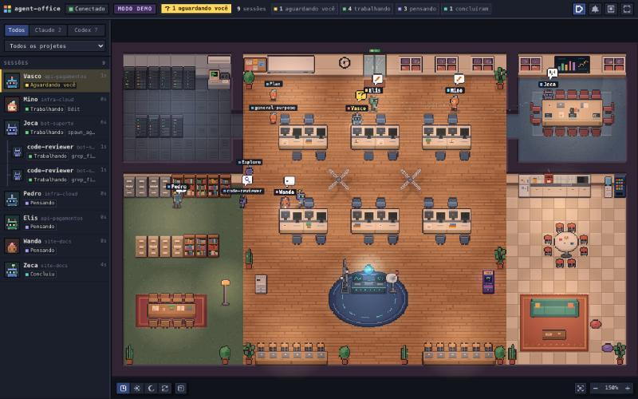

# agent-office

Um escritório 2D em pixel art, animado e interativo, que mostra **em tempo real** todas as suas sessões e subagentes do **Claude Code** e do **Codex** rodando na sua máquina. Cada sessão é um personagem: ele entra pela porta, senta na mesa para programar, vai à estante para ler, à sala de servidores para rodar comandos, ao quadro branco para planejar — e levanta um balão quando está esperando por você.

Tudo roda **somente em `127.0.0.1`**. Nada sai da sua máquina.



```
┌──────────────┐  hooks (POST /events)   ┌───────────────────────┐  WebSocket   ┌──────────────┐
│ Claude Code  ├────────────────────────►│                       ├─────────────►│  navegador   │
│ Codex        │                         │  servidor agent-office│              │ escritório 2D│
└──────┬───────┘  transcripts (watcher)  │  127.0.0.1:4747       │◄─────────────┤ React + Pixi │
       └────────────────────────────────►│  estado + SQLite      │   REST       └──────────────┘
          ~/.claude/projects, ~/.codex/sessions └───────────────────────┘
```

## Requisitos

- Node.js **22.13 ou mais novo** (usa o `node:sqlite` nativo — não há módulos compilados)
- macOS, Linux ou Windows (macOS é a plataforma testada no dia a dia)
- Claude Code e/ou Codex instalados (um dos dois já basta)

## Instalação

```bash
git clone git@github.com:andrade-ramon/agent-office.git ~/github/agent-office
cd ~/github/agent-office
npm install
npm run build
npm link -w @agent-office/hooks     # disponibiliza o comando `agent-office`
```

Depois, três comandos:

```bash
agent-office connect            # instala os hooks no Claude Code e no Codex
agent-office service install    # sobe o servidor e configura a inicialização automática
agent-office doctor             # confere se está tudo certo
```

Abra **http://localhost:4747**.

> Sem `npm link`, use `npm run agent-office -- <comando>` na raiz do repositório.

## Uso

| Comando | O que faz |
|---|---|
| `agent-office connect` | Instala os hooks (mescla com os seus, faz backup, é idempotente). `--claude` / `--codex` para um só. `--port <n>` troca a porta. |
| `agent-office disconnect` | Remove **somente** os hooks do agent-office e restaura o arquivo original. |
| `agent-office status` | Servidor, hooks e inicialização automática em um relance. |
| `agent-office start` | Inicia o servidor em segundo plano. `--foreground` roda no terminal; `--open` abre o navegador. |
| `agent-office stop` | Para o servidor. |
| `agent-office restart` | Reinicia o servidor. |
| `agent-office open` | Abre a interface no navegador. |
| `agent-office service install\|uninstall\|status\|restart` | Inicialização automática (launchd no macOS, `systemd --user` no Linux, Tarefa Agendada no Windows). |
| `agent-office doctor` | Diagnóstico completo, incluindo o teste de fail-open do hook. |
| `agent-office fix-settings` | Corrige problemas conhecidos do `~/.claude/settings.json` que fazem o Claude Code ignorar o arquivo. |
| `agent-office uninstall` | `disconnect` + remove o serviço. `--purge` apaga `~/.agent-office`. |

### Modo demo

Para ver o escritório funcionando sem nenhum agente real:

```bash
npm run demo      # compila e abre http://localhost:4748 com sessões simuladas
```

O demo usa outra porta (4748), não lê seus transcripts e não grava histórico.

### Na interface

- **Clique** em um personagem: painel com o **assunto** da sessão, agente, projeto, diretório, ferramenta atual, uso de contexto, tempo ativo e linha do tempo recente.
- **Assunto**: cada sessão mostra, em poucas palavras, no que está trabalhando — o título que o próprio agente dá à sessão (Claude Code) ou à thread (Codex) e, para subagentes, a descrição curta da tarefa. Aparece na lista, no painel e na etiqueta do personagem.
- **Painéis redimensionáveis**: arraste a borda da lista de sessões ou do painel de detalhes para ajustar a largura (duplo clique na borda volta ao padrão; a largura fica salva).
- **Duplo clique**: tenta trazer o terminal/app daquela sessão para frente (quando o sistema permite).
- **Arrastar** move a câmera, **roda do mouse** dá zoom, **Focar** segue o personagem selecionado.
- Filtros por agente e por projeto, lista lateral de sessões, modo compacto e tela cheia.
- Quem está **aguardando você** (pergunta ou pedido de permissão) ganha balão, anel pulsante, destaque na lista e contador no título da aba. Notificações de desktop são opcionais.

### O que cada lugar significa

| Lugar | Quando o personagem vai para lá |
|---|---|
| Mesas | escrevendo ou editando código (`write`, `edit`) e pensando |
| Estante / arquivo | lendo arquivos ou buscando (`read`, `search`) |
| Sala de servidores | rodando comandos (`bash`) |
| Quadro branco | planejando (`plan`) |
| Estação web | buscando ou navegando na web (`web`) |
| Sala de reunião | subagentes e o agente que os delegou |
| Copa | sessão ociosa (`idle`) |
| Porta | sessões chegando e saindo |

## Como funciona

Monorepo TypeScript com npm workspaces:

| Pacote | Papel |
|---|---|
| [`packages/server`](packages/server) | Node + Fastify + `ws`. Recebe eventos, mantém o estado das sessões em memória, persiste histórico em SQLite e transmite por WebSocket. Serve o front-end. |
| [`packages/web`](packages/web) | Vite + React + PixiJS. O escritório, os personagens (sprites gerados em código), pathfinding e a interface. |
| [`packages/hooks`](packages/hooks) | A CLI `agent-office` e o script de hook. |

### Duas vias de ingestão

1. **Hooks** (`POST /events`) — o caminho rápido. `agent-office connect` registra um comando nos hooks do Claude Code (`~/.claude/settings.json`) e do Codex (`~/.codex/hooks.json`).
2. **Watcher de arquivos** (chokidar) — a garantia. O servidor acompanha `~/.claude/projects/**/*.jsonl` e `~/.codex/sessions/**/*.jsonl`. É o que mostra sessões que já estavam abertas, e o que cobre qualquer agente cujos hooks não estejam ativos.

As duas vias convergem para um schema único e são deduplicadas (pelo id da chamada de ferramenta, ou por tipo de evento dentro de uma janela curta):

```ts
{
  agent: "claude" | "codex",
  sessionId, parentSessionId?, cwd, project,
  event: "session_start" | "prompt" | "tool_start" | "tool_end" | "subagent_start" | "subagent_stop"
       | "waiting_input" | "permission_wait" | "error" | "stop" | "session_end",
  toolCategory: "read" | "write" | "edit" | "bash" | "search" | "web" | "plan" | "other",
  ts
}
```

Além disso, o servidor lê `~/.claude/sessions/<pid>.json` (um arquivo por processo vivo do Claude Code) para saber quais sessões continuam abertas mesmo paradas há horas, quando o processo saiu e — importante — quando a sessão está **parada esperando você** (por exemplo, num pedido de permissão), mesmo sem hooks.

### Estados de uma sessão

`starting → thinking ⇄ working → done`, com `waiting_input`, `permission_wait` e `error` no meio do caminho. Sem eventos por **5 minutos** a sessão vira `idle` (vai para a copa); depois de **30 minutos** — e sem um processo vivo conhecido — é considerada encerrada. Os dois tempos são configuráveis em `~/.agent-office/config.json`:

```json
{ "port": 4747, "idleAfterMin": 5, "endAfterMin": 30, "titles": true }
```

### O hook nunca atrapalha o agente

O script de hook (`~/.agent-office/bin/agent-office-hook`) é **fail-open**:

- timeout HTTP de 400 ms e teto absoluto de 1,2 s de execução;
- sai **sempre** com código 0 e nunca imprime nada (stdout vazio não altera o contexto do agente);
- os hooks de ferramenta usam `async: true`, ou seja, rodam em segundo plano;
- se o servidor estiver desligado, o Node estiver ausente ou o arquivo tiver sido apagado, o comando simplesmente não faz nada.

`agent-office doctor` testa isso de verdade a cada execução (servidor "fora do ar" → exit 0, sem saída).

## Privacidade

- O servidor escuta **somente em `127.0.0.1`**, valida o cabeçalho `Host` e recusa requisições e WebSockets com `Origin` de fora do loopback (nenhum site que você visite consegue ler ou injetar eventos).
- O hook envia **apenas metadados**: tipo do evento, nome/categoria da ferramenta, `cwd`, ids de sessão/ferramenta, modelo, modo de permissão e o título da sessão. Prompts, respostas, argumentos e saídas de ferramentas e conteúdo de arquivos são descartados dentro do próprio script, antes de qualquer envio — veja a lista `ALLOW` em [`agent-office-hook.mjs`](packages/hooks/hook/agent-office-hook.mjs).
- **Assunto da sessão**: a única informação derivada do conteúdo é o título curto (até 90 caracteres) que o próprio agente dá à sessão — o mesmo que aparece na barra lateral do Claude ou do Codex — e a descrição curta da tarefa de um subagente. Fica só na sua máquina, em memória (não vai para o SQLite). Para não exibir nem isso, use `"titles": false` em `~/.agent-office/config.json` e reinicie o servidor.
- O watcher lê os transcripts localmente apenas para classificar cada linha (é um prompt? uma chamada de ferramenta?). Nenhum conteúdo é guardado, transmitido ao navegador ou gravado no SQLite.
- O histórico (`~/.agent-office/agent-office.db`) guarda eventos e contagens por 30 dias. Nada mais.
- Não há telemetria, CDN, fontes remotas nem qualquer requisição para fora.

## Sobre os hooks de cada agente

**Claude Code** — os hooks entram em `~/.claude/settings.json`, em um grupo próprio no fim de cada evento (`SessionStart`, `UserPromptSubmit`, `PreToolUse`, `PostToolUse`, `PostToolUseFailure`, `PermissionRequest`, `Notification`, `SubagentStart`, `SubagentStop`, `Stop`, `StopFailure`, `SessionEnd`). Seus hooks existentes não são tocados. Antes de alterar o arquivo é feito um backup em `~/.agent-office/backups/`.

**Codex** — os hooks entram em `~/.codex/hooks.json` (o conjunto de eventos respeita a versão instalada). O Codex **só executa hooks depois que você os aprova uma vez**: abra o Codex e use `/hooks` (CLI) ou "Review hooks" (app de desktop). Até lá — e como garantia permanente — o watcher de `~/.codex/sessions` mostra as sessões do Codex normalmente.

## Desinstalação

```bash
agent-office uninstall           # remove os hooks e o serviço; mantém histórico e backups
agent-office uninstall --purge   # idem, e apaga ~/.agent-office
npm unlink -g @agent-office/hooks
```

`disconnect` remove somente o que é do agent-office. Se o arquivo não mudou desde o `connect`, ele é restaurado **byte a byte** a partir do backup original; se você editou outras coisas nesse meio-tempo, só os nossos hooks saem e o resto fica como está. Um `hooks.json` criado por nós é apagado.

## Troubleshooting

Comece sempre por `agent-office doctor`.

**A página não abre.**
`agent-office status` mostra se o servidor está no ar. Log em `~/.agent-office/logs/server.log`. Se a porta 4747 estiver ocupada, use `agent-office connect --port 4800` seguido de `agent-office service install`.

**Vejo "front-end não compilado".**
Rode `npm run build` e `agent-office restart` (o reinício só é necessário na primeira vez; depois, os novos builds são servidos direto).

**Minhas sessões do Claude aparecem, mas "último hook recebido: nunca".**
Duas causas comuns:

1. Sessões abertas antes do `connect` continuam pelo watcher; os hooks valem para sessões novas.
2. O Claude Code **ignora o `settings.json` inteiro** quando alguma chave falha na validação — por exemplo, um `statusLine` sem `"type": "command"`. Nesse caso nenhum hook seu funciona (nem as regras de permissão). Rode `claude -p "oi"` no terminal: se aparecer *"These settings files did not load"*, é isso. O `doctor` detecta os casos conhecidos e `agent-office fix-settings` corrige (com backup).

**As sessões do Codex aparecem, mas os hooks do Codex não disparam.**
Falta aprovar os hooks dentro do Codex (`/hooks` ou "Review hooks"). O watcher segue cobrindo.

**Uma sessão ficou como "pensando" depois que eu interrompi.**
Sem hooks, o fim do turno é detectado pelo transcript; em até alguns segundos (ou no próximo evento) o estado se corrige. Sessões sem atividade viram `idle` em 5 minutos.

**O duplo clique não traz o terminal para frente.**
É melhor esforço: funciona para apps `.app` no macOS (Terminal e iTerm2 selecionam a aba certa; os demais só ativam a janela) e via `xdotool` em X11. O macOS pode pedir permissão de Automação na primeira vez.

**Quero zerar tudo.**
`agent-office uninstall --purge`.

## Desenvolvimento

```bash
npm run build        # compila servidor, CLI e front-end
npm test             # vitest: normalizador, máquina de estados, instalador de hooks, integração evento→WebSocket
npm run lint
npm run typecheck
npm run dev:web      # Vite com proxy para o servidor em 127.0.0.1:4747
```

O CI (GitHub Actions) roda lint, typecheck, build e testes em Node 22 e 24.

## Licença

[MIT](LICENSE). Toda a arte é gerada em código; veja [ATTRIBUTIONS.md](ATTRIBUTIONS.md).
